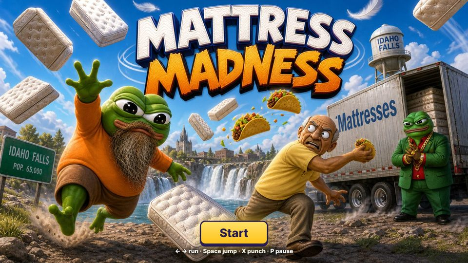
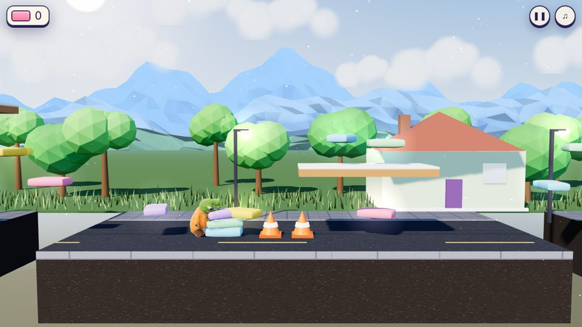
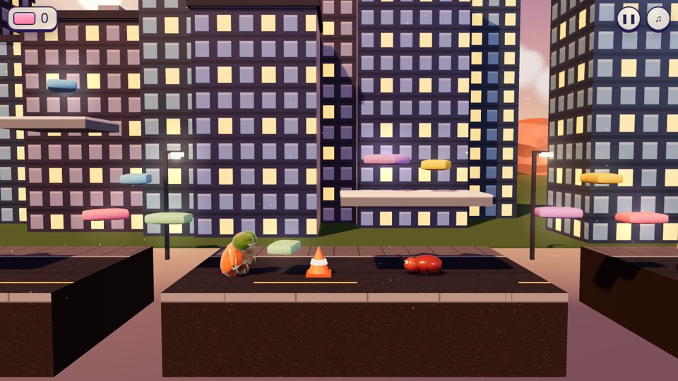
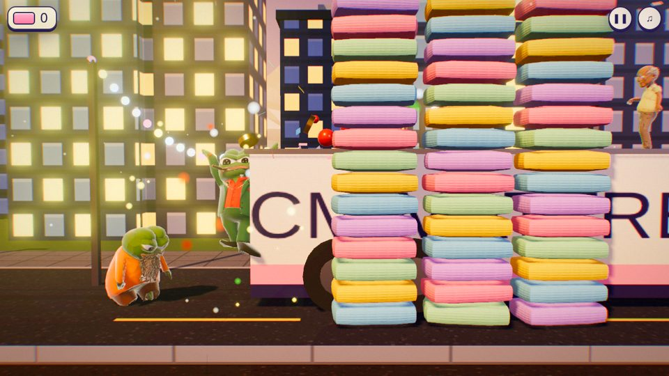
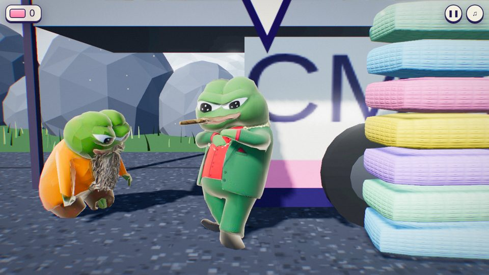

# Mattress Madness

A 3D side-scrolling platformer through Idaho Falls. Play as CornPop, grab every mattress you can, dodge Boojos, Ballinkis, bedbugs and flying tacos, and deliver the haul to BCM's trailer. Deliver a big load and BCM celebrates by hurling jars of his pasta sauce everywhere. Come up short and he throws a tantrum and curses you to hell.

Runs in any modern browser with WebGL. No install, no build step.



| | |
|---|---|
|  |  |
|  |  |

## Play

- **Online:** see the GitHub Pages link in the repo's About section (once Pages is enabled, see below).
- **Offline:** download `MattressMadness-offline.html` from the Pages site (or build it yourself, below) and double-click it.
- **Locally from source:** browsers block loading game files from `file://`, so serve the folder:

  ```bash
  python3 -m http.server 8000
  # then open http://localhost:8000
  ```

## Controls

| Action | Keyboard / mouse | Controller |
|---|---|---|
| Move | `A` `D` or `←` `→` | Left stick / D-pad |
| Jump | `Space` (also `W`, `↑`) | A / ✕ |
| Punch | `J`, `K` or left-click | X / □, B / ○, RB / RT |
| Pause | `Esc` or `P` | Start |
| Mute | `M` | Select |
| Menus | `Enter`/`Space` to confirm, arrows/WASD/Tab to move | D-pad + A, B to resume |

On phones and tablets, on-screen buttons appear automatically.

**Pause menu options:** music volume, camera distance (Out/In), and graphics quality. *Next-gen* uses HDR bloom, MSAA and soft shadows. *Fast* is for weaker devices. The game switches itself to *Fast* if the frame rate drops too low.

## Levels

1. Suburban Streets to Broadway
2. Downtown to the Snake River
3. Tautphaug Park to the Temple

Collect 70%+ of a level's mattresses to make BCM happy, 35%+ to keep him from losing it.

## Project layout

```
index.html              page, HUD and styles
src/game.js             the whole game: rendering, gameplay, BCM's animation rig, audio, input
lib/                    three.js r128 + examples (GLTFLoader, SkeletonUtils, post-processing). MIT, see LICENSE-three.js.txt
assets/                 character models (.glb), music, title art
tools/build-single.py   bundles everything into one offline HTML file
.github/workflows/      GitHub Pages deployment
docs/screenshots/       images for this README
```

### Tech notes

- **Rendering:** three.js r128 with a linear colour workflow, ACES filmic tone mapping, HDR render target with 4× MSAA, UnrealBloom, and a custom final pass (vignette, grade, light chromatic aberration, grain). Also a sun shadow map that follows the camera, a procedural sky dome reused for image-based lighting (PMREM), and instanced wind-swayed grass.
- **BCM's reactions:** his model only ships with Idle/Walk/Run clips, so `src/game.js` layers a procedural rig on top. It aims his limbs at character-space directions in world space, which is robust to the auto-rig's odd bone axes. That rig drives the clapping, waving, the jump-spin, pasta-sauce throws, crossed arms, shrugs and the tantrum.
- **Debug hooks:** set `window.MANUAL = true` in the console to stop the main loop, then call `update(1/60)` to step frames manually.

## Building the offline file

```bash
python3 tools/build-single.py            # writes dist/MattressMadness.html (~16 MB)
```

## Deploying to GitHub Pages

1. Push this repo to GitHub (default branch `main`).
2. **Settings → Pages → Build and deployment → Source:** choose **GitHub Actions**.
3. The included workflow publishes the game on every push. The offline file is served at `/MattressMadness-offline.html`.

## Credits & licensing

- three.js © three.js authors, MIT License (`lib/LICENSE-three.js.txt`).
- Characters, title art and music are the game's original assets. Add a `LICENSE` file stating the terms you want for the code and assets before making the repo public.
